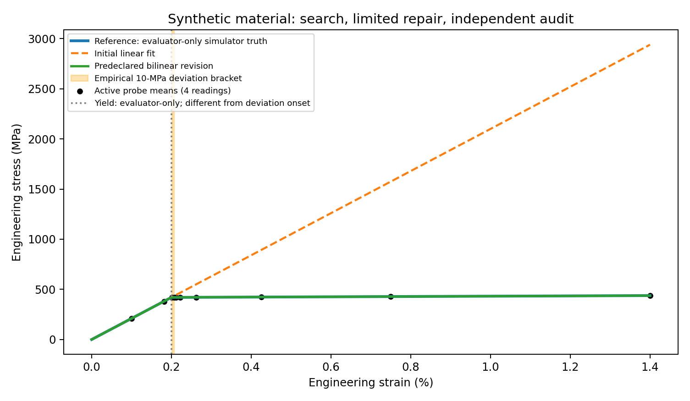

# FalsifyLab

Find a plausible law. Challenge it. Attempt a limited repair. Keep the evidence.

FalsifyLab is a local **synthetic scientific-computing prototype** for auditing
physical relationships. It records where a model fails and whether a constrained
revision survives new observations. The output is an executable evidence trace,
not a formal mathematical/statistical proof or a new physical discovery.



## Run locally

Use Python 3.12 (tested with 3.12.3) and a CPU. No API key, GPU or private data is
needed. Installation downloads dependencies; all experiments then run locally.

```bash
# In the author's existing environment:
source ~/.venvs/lesegenv/bin/activate
# Or create your own:
# python3.12 -m venv .venv
# source .venv/bin/activate
pip install -r requirements.txt
python -m falsifylab
python -m pytest -q
```

The one-command demo runs three oscillator controls, 30 material noise seeds,
exports four validated certificates, verifies raw-data metrics, and produces
[`outputs/demo.html`](outputs/demo.html). Open that file locally in a browser.
For a smaller smoke run: `python -m falsifylab --seeds 2 --out /tmp/falsifylab-demo`.
For exact tested dependency versions: `pip install -r requirements-lock.txt`.
The full 22-package lock was installed and exercised in an isolated environment.

## Reproduce the full evaluation

```bash
python -m falsifylab.benchmark --seeds 30 --out outputs/benchmark
python -m falsifylab.make_report
python -m falsifylab.verify outputs
python -m falsifylab.submission
```

Or run all experiments and reporting with `python -m falsifylab --benchmark`.
Individual benchmark CLIs remain available:

```bash
python -m falsifylab.run_demo
python -m falsifylab.run_materials --seeds 30 --out outputs/materials
python -m falsifylab.certificates outputs/certificates/oscillator.json outputs/certificates/materials.json
```

Final aggregate numbers, quartiles, budgets, controls, ablations, solver sensitivity
and observed failures are generated in [`docs/EVALUATION.md`](docs/EVALUATION.md).
Machine-readable records are in [`metrics.json`](outputs/benchmark/metrics.json)
and [`metrics.csv`](outputs/benchmark/metrics.csv). All seeds and robustness
settings are predeclared in [`docs/PROTOCOL.md`](docs/PROTOCOL.md).

## Scientific workbench (browser)

[`site/index.html`](site/index.html) is a static workbench. Serve the repository root
(`python -m http.server`) and open `/site/index.html`, or enable GitHub Pages on the
repository root; the root `index.html` redirects there. Panels are labelled:

- **Live**: computed in your browser by `site/assets/engine.js`, a JavaScript port of the
  engine. `node site/tests/engine_parity.mjs` replays recorded Python runs through it;
  1,500/1,500 checks match. Live runs are exploratory.
- **Recorded**: replays of committed evidence, bundled by `python site/build.py` with the
  SHA-256 of every input file.
- **Post-hoc**: the independent audit's extra experiments, which are not part of the frozen protocol.

Browser QA (`site/tests/browser_qa.py`, Playwright) covers controls, desktop and mobile
layouts, console errors, links and in-browser hash verification. Screenshots are in
`docs/screenshots/`.

## Independent review

[`docs/INDEPENDENT_AUDIT.md`](docs/INDEPENDENT_AUDIT.md) reproduces the
benchmark: 184 of 187 files byte-identical, including every raw array. It re-derives the
mathematics and frozen models and adds post-hoc experiments. Read the headline numbers
with its corrections:

- **Bracket width.** The 5.1e-5 strain active bracket is bisection's design resolution
  (0.013/2^8).
- **Audit error.** All three policies reach the same ~0.40 MPa audit error, the
  measurement floor (0.37 MPa). That gain comes from the declared bilinear family, not
  from the search.
- **Noise.** Under heavier noise the active bracket loses coverage (17/29 at 8 MPa over
  30 seeds). All 38 post-hoc misses fell where the engine abstained on every run. That
  abstention is blunt: it also abstains on many correct brackets, and it is given the true
  noise SD.
- **False refutation.** At 0.01 instrument noise the valid harmonic law is refuted in 4/30 runs.
- **Local failures.** With a hidden softening dip, both bisection and the mean-error audit miss a
  25 MPa local failure. Audits interpolate inside the probed range.
- **Oscillator seeds.** Primary runs are one deterministic noise-free pipeline audited on
  30 jittered final sets.
- **Search under noise.** The discovery-only quartic fails; the search-selected revision is
  never refuted but is mostly inconclusive (confirmed in 4/60 runs), and one largest-amplitude
  run without search does as well.
- **History.** The development history is not published. Commit identifiers in the documents
  refer to it; each evidence record's source SHA-256 hashes match the published files.

Judge-facing answers: [`docs/JUDGE_QA.md`](docs/JUDGE_QA.md). Prior work:
[`docs/CLAIM_NOVELTY_TABLE.md`](docs/CLAIM_NOVELTY_TABLE.md).

## What the experiments mean

**Materials.** A synthetic continuous bilinear response stands in for idealized
uniaxial loading. Discovery fits a zero-intercept Hookean slope at low strains.
The boundary is where absolute prediction error exceeds **10 MPa**. This
operational deviation onset differs from physical yield. Adaptive bisection,
uniform and random sampling share discovery data and receive **10 probes / 40
stress readings each**. Setup (40 readings) and final audit (249 readings) are
counted separately. A preselected bilinear family is fitted from observations;
simulator coefficients are available only to the laboratory and evaluator.
Random locations and measurement noise have independent RNG streams.

Boundary width, noiseless-target coverage and abstention are all reported.
Revised audit status compares aggregate MAE with 10 MPa; it is weaker than a
pointwise bound at every strain. The active empirical bracket can be narrow and wrong at higher noise. The
uncertainty-aware observed interval is also **not a confidence interval**.
Bisection assumes one pass-to-fail transition; unsampled nonmonotonicity may be
missed. Repeated seeds represent one material, not independent physical specimens.

**Mechanics.** The environment solves `x''=-omega²x-alpha*x³-gamma*x'` using DOP853.
Nominal units: x in m, time in s, velocity in m/s. The fitter only sees observed
state pairs, fitting `Q=v²+a*x²` then optionally `Q=v²+a*x²+b*x⁴`. Each trajectory
is centered separately. For gamma=0 the physical scaled energy is
`v²+omega²*x²+(alpha/2)*x⁴`; its derivative with damping is `-2*gamma*v²`.
The energy-balance test checks this independently using integrated dissipated power.

A fixed 15-condition amplitude/horizon catalog challenges the quadratic law;
a selected additional trajectory supports revision. Models freeze before three
new final trajectories are acquired. Ledger costs include all discovery, search,
revision, audit calls, state readings, simulated time and ODE RHS evaluations.
The amplitude boundary is a finite observed grid, not a continuous validity guarantee.

The oscillator **2% peak-to-peak/mean-absolute-level drift threshold** is a
`DEMONSTRATION_THRESHOLD`, not a p-value. Instrument-noise allowances provide
conservative heuristic abstention, without formal coverage or error control.
Valid harmonic and damped failure controls, two solver tolerances, noise/horizon
checks and a discovery-only quartic ablation are included. The latter also fits
the noiseless Duffing invariant: these experiments do not establish that search
is needed for recovery in a correctly specified richer family.

## Inspect and independently recompute the evidence

- [`outputs/certificates/oscillator.json`](outputs/certificates/oscillator.json)
  and [`readable trace`](outputs/certificates/oscillator.md).
- [`outputs/certificates/materials.json`](outputs/certificates/materials.json)
  and [`readable trace`](outputs/certificates/materials.md).
- [`falsifylab/schema.json`](falsifylab/schema.json) defines evidence schema 1.0.0.
- Each certificate has run ID, UTC timestamp, seed, Git/source hashes, dependencies,
  units, domain, uncertainty, disjoint partitions, frozen models, complete queue,
  resource costs, counterexamples, revision, final audit, artifact hashes and limits.
- Raw arrays are portable `.npz` files; load with `numpy.load(..., allow_pickle=False)`.
  `falsifylab.verify` recomputes probe/audit metrics from these arrays, verifies
  source-linked certificate metrics, frozen models, partitions, counts and hashes.

Statuses are `REFUTED`, `NOT_REFUTED_UNDER_TESTED_CONDITIONS` and `INCONCLUSIVE`.
A missing counterexample or surviving audit never proves a law. Invalid data,
degenerate trajectories, incompatible units, unidentifiable fits and contradictory
brackets are rejected or explicitly inconclusive. Every attempted logged simulation,
including failures, is counted. There are no automatic retries or cloud calls.

## Architecture

| Module | Responsibility |
|---|---|
| `physics.py`, `materials.py` | Numerical laboratories, observation-only constrained fits |
| `hypothesis.py`, `decisions.py` | Fixed polynomial family, guarded metrics and abstention |
| `experiments.py` | Counted queue, partitions, raw readings, model-freeze guard |
| `run_demo.py`, `run_materials.py` | Actual scientific workflows and figures |
| `benchmark.py` | Equal-budget trials, controls, robustness, ablations, CSV/JSON |
| `certificates.py`, `verify.py` | Schema, provenance, checksums and raw-data recomputation |
| `make_report.py`, `submission.py` | Offline viewer and drafts generated from results |

## History, limitations and related work

The original ten tests and both supplied benchmarks reproduced exactly. Original
outputs are preserved in [`baseline/`](baseline/). V1 and development V2 holdouts
are development data; V3 uses a newly frozen final split and independent streams.
Changed final numbers reflect those declared changes, not a silent rewrite of
historical results. Loose files originally supplied at the repository root remain
historical; `outputs/demo.html` and `submission/*FINAL*` are the current artifacts.

There is no real-material validation, unrestricted equation discovery, trained AI
agent, calibrated hypothesis test, state-of-the-art comparison, or demonstrated
first-invention claim. The proposed contribution is an inspectable integration of
existing ideas. Primary-source attribution and distinctions appear in
[`docs/RELATED_WORK.md`](docs/RELATED_WORK.md), covering SINDy, PySR, POPPER and
SciExplorer. Independent review: [`docs/INDEPENDENT_AUDIT.md`](docs/INDEPENDENT_AUDIT.md).

## Reports and submission materials

- Engineering report: [`docs/ENGINEERING_REPORT.md`](docs/ENGINEERING_REPORT.md)
- Independent audit: [`docs/INDEPENDENT_AUDIT.md`](docs/INDEPENDENT_AUDIT.md)
- Frozen evaluation: [`docs/EVALUATION.md`](docs/EVALUATION.md)
- Answers to judging questions: [`docs/JUDGE_QA.md`](docs/JUDGE_QA.md)
- Submission write-up, video script, post and figures: [`submission/`](submission/README.md)

`python -m falsifylab.submission` regenerates an automatic draft (`submission/MOMENT_WRITEUP_GENERATED.md`, not tracked);
`python submission/make_figures.py` regenerates the figures from the evidence files.
No publication or competition submission is performed by this software.

Released under the [MIT License](LICENSE).

## Optional marimo scientific notebook

```bash
pip install -r requirements-notebook.txt
python -m marimo run notebooks/explore.py
```

The notebook is reactive. Each control reruns the actual engine
(`falsifylab.run_materials.run`, `falsifylab.run_demo.run_case`) with unchanged thresholds,
budgets and families:

- Materials: choose the hidden material (including a nonmonotone softening-dip case),
  the instrument noise and the seed.
- Oscillator: choose the system, noise and horizon factor.
- Your own Duffing stress amplitude: a low-amplitude probe can find no counterexample and
  decline revision.

Runs are exploratory, not new untouched holdouts. The oscillator audit reuses the v3 final
conditions. Helpers live in `notebooks/exploration.py`, tested by
`tests/test_notebook_exploration.py`. `site/tests/marimo_ui_qa.py` drives `marimo run` in
a browser and checks that controls rerun the engine (log in
`docs/logs/audit/marimo-ui-qa.txt`). The default demo and tests do not require marimo.

Create a portable local bundle with `python -m falsifylab.package`. It verifies
evidence first, writes `dist/FalsifyLab_bundle.zip`, and includes a per-file
checksum manifest and Git checkpoint. No hosting or publication occurs.
